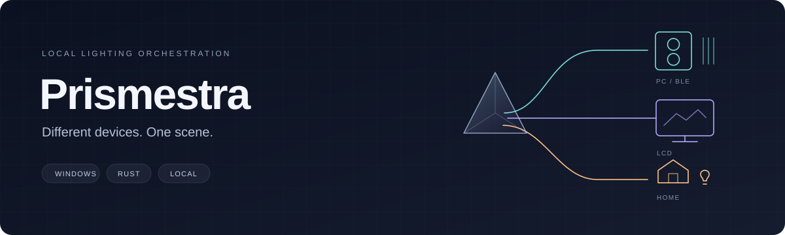

<p align="center">
  
</p>

<p align="center">
  <a href="https://github.com/malyarq/prismestra/actions/workflows/windows.yml"></a>
  
  
  <a href="LICENSE"></a>
</p>

<p align="center">
  <a href="#what-it-does">Features</a> ·
  <a href="docs/compatibility.md">Compatibility</a> ·
  <a href="#build-and-run">Build</a> ·
  <a href="CONTRIBUTING.md">Contribute</a>
</p>

Prismestra is a local lighting orchestrator for Windows. Its goal is to bring PC RGB, unusual Bluetooth lights, LCD displays and home lighting into one spatial scene, with explicit device support and a small resident engine.

**Source preview.** The scene engine, native editor and OpenRGB/WLED/Home Assistant setup paths are implemented and have software tests. Home Assistant tokens use Windows Credential Manager. Hardware acceptance, enabling native control from an ordinary GUI launch, and keeping the engine alive after closing the editor are still in progress. See the [compatibility table](docs/compatibility.md) before choosing a device.

## What it does

- **One canvas.** Place outputs in a shared scene, combine effects and sample screen content through the [lighting engine](src/lighting) and [desktop capture](src/capture).
- **RGB and LCD together.** Compose images, animation and temperature overlays through the [LCD pipeline](src/lcd), alongside independently paced lighting outputs.
- **Reuse existing support.** Reach an OpenRGB SDK6 server through a [bounded adapter](src/transport/openrgb.rs), send realtime frames to [WLED](src/transport/wled.rs), and submit whole-light colors to [Home Assistant](src/transport/home_assistant.rs).
- **Keep personal setup local.** [Portable scenes](src/app/document.rs) are separate from [local device bindings](src/app/lighting_bindings.rs).
- **Activate deliberately.** Discovery, saving a connection and taking ownership of its output are separate steps. A successful submission is reported as submission, not proof that a physical light changed.

Prismestra does not control fans or pumps. Keep your existing cooling software. Temperature inputs are read-only.

## Build and run

Install a current stable [Rust toolchain](https://www.rust-lang.org/tools/install) with the Windows MSVC build tools, then:

```powershell
git clone https://github.com/malyarq/prismestra.git
cd prismestra
cargo build --release --locked --bin pc-control-ui
.\target\release\pc-control-ui.exe
```

The internal crate and executable still use `pc-control` and `pc-control-ui`. The product name is **Prismestra**.

First launch opens a preview. Set up and inspect a supported connection before applying it. When using an external backend, configure its server separately; Prismestra does not install or silently take over another controller.

## Compatibility is a testable claim

USB, a wireless dongle and Bluetooth on the same keyboard can expose different protocols. A supported vendor name alone is not enough.

We distinguish protocol implementation, software tests, an available setup path and testing on a particular physical device. Fake TCP/HTTP servers and UDP receivers validate packets and failure handling. They cannot validate colors, firmware behavior or radio stability. Device-specific details belong in the [compatibility table](docs/compatibility.md).

The immediate focus is RGB, BLE, LCD and local home lighting. Native Windows Dynamic Lighting/LampArray support and additional protocols remain future work. There is no claim of universal Bluetooth or LCD support.

## Development

```powershell
cargo fmt --all -- --check
cargo check --locked --all-targets
cargo test --locked -- --test-threads=1
cargo clippy --locked --all-targets -- -D warnings
```

The [Windows workflow](.github/workflows/windows.yml) checks software behavior without real device activation. Tests use fixtures, temporary files and loopback servers. Physical acceptance and resource measurements are separate work; no performance numbers are claimed yet.

To report a device or help add one, start with [contributing](CONTRIBUTING.md). A precise model, revision, firmware and connection mode are more useful than a vendor-wide support request.

Maintainers can build a package with its exact source, dependency sources, licenses and checksums using the [release instructions](docs/releasing.md).

## Upstream work and license

| Component | Use | License / source |
| --- | --- | --- |
| OpenRGB | External device backend through its SDK | [OpenRGB](https://github.com/CalcProgrammer1/OpenRGB), GPL-2.0-or-later |
| openrgb2 0.4.1 | Vendored Rust SDK client with bounded parsing and direct-output fixes | [Source and patch record](vendor/openrgb2/LOCAL-CHANGES.md), GPL-2.0 |
| WLED | External realtime lighting receiver over DDP | [WLED](https://github.com/Aircoookie/WLED); no firmware source copied into this adapter |
| Home Assistant | External light entities through its REST API | [REST API](https://developers.home-assistant.io/docs/api/rest/); no server source copied |

Original source is [GPL-2.0-or-later](LICENSE), unless a file states otherwise. Third-party components retain their licenses and notices; combined distributions must satisfy all applicable terms. Protocol fixtures record their provenance alongside the data.

Prismestra is independent of OpenRGB, WLED, Home Assistant and hardware vendors.
